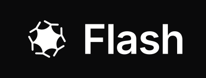
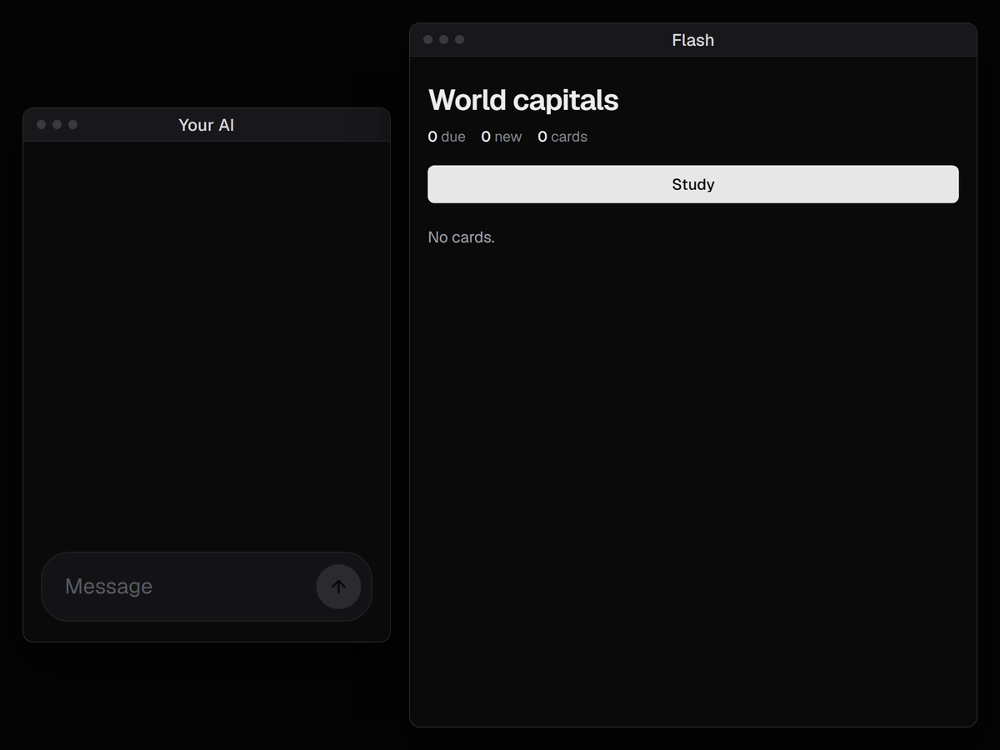

<p align="center"></p>

<p align="center">Your AI makes the flashcards, Flash makes sure you remember them.</p>

<p align="center">
  <a href="https://flashmemorize.com">Hosted version</a> ·
  <a href=".env.example">Every setting</a> ·
  <a href="crates/flash-server/MCP.md">MCP tools</a> ·
  <a href="CHANGELOG.md">Changelog</a> ·
  <a href="CONTRIBUTING.md">Contributing</a>
</p>



A self-hosted spaced-repetition server. Connect ChatGPT, Claude or any MCP
client: it writes cards into your decks and quizzes you, and Flash schedules
every review with [FSRS](https://github.com/open-spaced-repetition/fsrs-rs).
One Rust binary, one data folder. Imports and exports Anki `.apkg` decks.

## Run it

```sh
docker run -d --name flash -p 127.0.0.1:8437:8437 -v flash-data:/data ghcr.io/flash-cards/flash
docker logs flash | grep enroll
```

Open the enroll link at http://localhost:8437 and you are the admin; invite
everyone else from Settings. To serve it beyond your machine, put a TLS
reverse proxy in front and set `FLASH_BASE_URL` to its address
([docker-compose.yml](docker-compose.yml) is the hardened setup). Your data
is the `flash-data` volume: back it up, and upgrade by pulling a newer image
and recreating the container. Locked out?
`docker exec flash flash-server reset-link you@example.com` prints a link to
choose a new password (with compose: `docker compose exec flash ...`).

Installed with `docker compose` (as up to 0.3.0)? Your data is in that
folder's volume (`docker volume ls`, e.g. `flash_flash-data`), not in
`flash-data`. Upgrade from the same folder, backing up first, since
upgrades only go forward:

```sh
docker compose stop flash
docker run --rm -v flash_flash-data:/data -v "$PWD":/backup debian:bookworm-slim \
    tar czf /backup/flash-data.tgz -C /data .
docker compose pull && docker compose up -d
```

## Connect your AI

Add `https://<your host>/mcp` as a custom connector in ChatGPT, Claude, Grok,
Le Chat or Gemini (OAuth, no keys to copy). In a terminal:
`claude mcp add --transport http flash https://<your host>/mcp`. Then say
"quiz me on my deck".

The [hosted version](https://flashmemorize.com) adds card generation from
your files and grading of spoken answers.

## License

[AGPL-3.0-only](LICENSE), with embedded assets in
[THIRD_PARTY.md](THIRD_PARTY.md). Contributions are accepted under the
[CLA](CLA.md).
