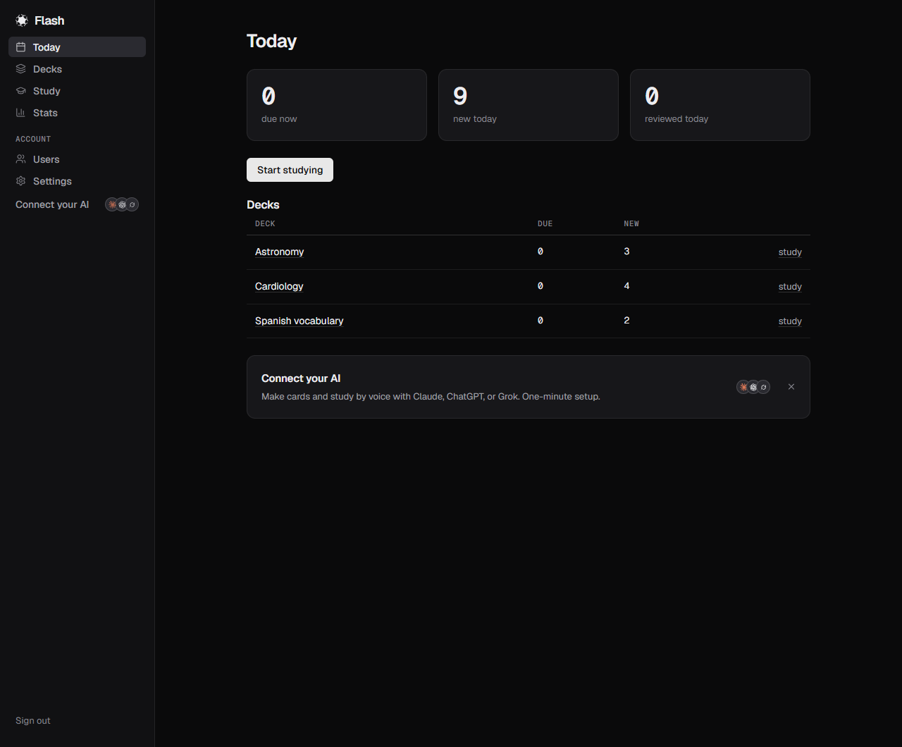
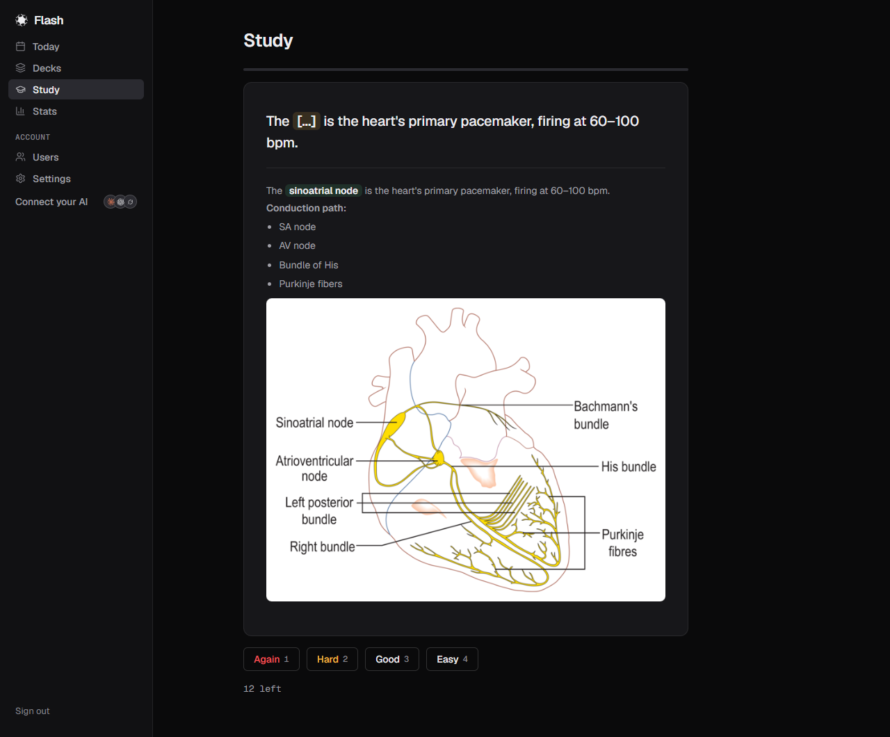
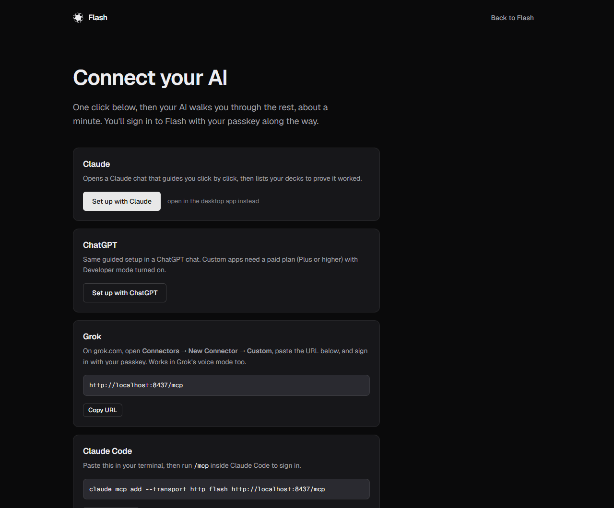

# Flash

Spaced-repetition flashcards you study with your AI. Flash is a small
self-hosted server: a web app for your decks and an [MCP](https://modelcontextprotocol.io)
server that lets Claude, ChatGPT, Grok or any MCP client create cards from
what you're learning, quiz you out loud, grade your answers and file the
reviews with the [FSRS](https://github.com/open-spaced-repetition/fsrs-rs)
scheduler. One Rust binary, one SQLite file, no accounts anywhere but yours.

The hosted version, with self-serve signup, Google/Apple sign-in and a
community deck library, is at [flashmemorize.com](https://flashmemorize.com).
iOS and Android apps are on the way and not out yet. This repository is
the core it all runs on.

| Today | Study | Connect your AI |
|---|---|---|
| [](screenshots/today.png) | [](screenshots/study.png) | [](screenshots/connect.png) |

<sub>Demo decks under the test persona; the conduction diagram is by Madhero88 via Wikimedia Commons, CC BY 3.0.</sub>

## Why not Anki + AnkiConnect?

AnkiConnect is a bridge into the desktop app: it only answers while Anki
is open on that machine, and it speaks Anki's own JSON, not MCP. Flash is
a server. It is reachable from your phone, from a Claude connector, from
Claude Code in a terminal, all at once, and the scheduling lives in the
server so every surface sees the same queue. It imports `.apkg` decks
whole (cloze, hints, images, audio, LaTeX, typed answers, nested decks)
and exports them back at any time, so trying it costs nothing.

## Five-minute quickstart (Docker)

```
git clone https://github.com/flash-cards/flash && cd flash
cp .env.example .env            # set FLASH_BASE_URL to the URL you'll reach it at
docker compose up -d
docker compose logs flash | grep enroll
```

The first boot finds an empty database and logs a one-time link:

```
no users yet. Enroll the first admin within 24h at:
https://cards.example.com/enroll/<token>
```

Open it, add a passkey or a password, and you are the admin. Every later
account is created from **Settings → Invite**: there is no public signup
on a self-hosted Flash, by design.

Without Docker: `cargo build --release -p flash-server`, then run
`target/release/flash-server` with the same environment variables. The
binary embeds its templates and static assets; it writes under
`FLASH_DATA_DIR`, plus short-lived scratch files for an import or export
in the system temp directory (the systemd unit gives it a private one).

## Upgrading

```
docker compose pull && docker compose up -d
```

Everything Flash writes lives in the `flash-data` volume (`/data` in the
container: the SQLite database, media, voice clips), and the image holds
nothing of yours, so a newer image finds your data where the old one
left it. On its first boot a newer version brings the database schema
forward before it listens, one step at a time, each in its own
transaction; `/healthz` then reports the new version. Migrations only go
forward: take a copy before an upgrade if you may want to return, and do
not start an older image on a volume a newer one has opened. A consistent
copy is the volume with the container stopped:

```
docker compose stop flash
docker run --rm -v flash-data:/data -v "$PWD":/backup debian:bookworm-slim \
    tar czf /backup/flash-data.tgz -C /data .
docker compose start flash
```

`latest` follows every release. `ghcr.io/flash-cards/flash:0.3` takes
patch releases only and `:0.3.0` never moves; pin one of those in
`docker-compose.yml` if you would rather choose when to move. What each
version changed is in [CHANGELOG.md](CHANGELOG.md), and a release that
changes the MCP tools says so there: refresh the connector's tool
definitions in each AI client after that upgrade. Without Docker the
same holds for `FLASH_DATA_DIR`: keep the directory, replace the binary,
start it.

## Connecting your AI

Flash serves MCP at `/mcp` (Streamable HTTP) with OAuth 2.1: the client
registers itself, sends you to Flash's login page, and gets a token
scoped to your account.

- **Claude.ai / Claude mobile**: Settings → Connectors → Add custom
  connector → paste `https://<your host>/mcp`. Claude's connectors need a
  publicly reachable HTTPS origin, so put Flash behind a reverse proxy
  with a certificate, such as Caddy:
  ```
  cards.example.com {
      reverse_proxy 127.0.0.1:8437 {
          header_up X-Real-IP {remote_host}
      }
  }
  ```
  and set `FLASH_CLIENT_IP_HEADER=x-real-ip` so the rate limiters see
  each visitor rather than the proxy (see the note under Configuration).
  A tunnel (Cloudflare Tunnel, Tailscale Funnel, ngrok) works the same
  way if you'd rather not open a port.
- **Claude Code**: `claude mcp add --transport http flash https://<your host>/mcp`.
  Claude Code and Claude Desktop run on your own machine, so a LAN address
  works for the MCP connection as long as `FLASH_BASE_URL` matches what
  you paste. The web UI itself needs HTTPS or `http://localhost`: its
  session cookie is marked Secure, and a browser drops it over plain http
  to any other host (the server says so at boot).
- **ChatGPT** (Plus and up, Developer mode): Settings → Apps → add the
  same URL as an MCP server. **Grok**: Connectors → New → Custom.

Once connected, say "quiz me on my pharmacology deck" and follow along.
The web app at `/` is where you import decks, edit cards and read your
stats. What the tools take and return, for anyone building a client, is
in [the MCP contract](crates/flash-server/MCP.md).

## Configuration

Everything is an environment variable; the core needs only the first
three. Optional groups are all-or-nothing: a partial set is a boot error,
an absent set turns the feature off.

| Variable | Default | What it does |
|---|---|---|
| `FLASH_BASE_URL` | `http://localhost:8437` | The public origin (`https://cards.example.com`). Passkeys, OAuth and every link in a mail are minted against it, so it must be what browsers actually see. A hostname, not an IP address: passkeys are bound to a domain, and `http://localhost:8437` is fine for a trial. |
| `FLASH_BIND` | `127.0.0.1:8437` | Listen address. The Docker image sets `0.0.0.0:8437`. |
| `FLASH_CLIENT_IP_HEADER` | unset | Header holding the real client address when a proxy is in front (`x-real-ip`, `cf-connecting-ip`). Unset uses the TCP peer. See the note below the table. |
| `FLASH_DATA_DIR` | `./data` | The SQLite database, import scratch space and media. Back this directory up. |
| `FLASH_SUPPORT_EMAIL` | unset | Shown on the pages that print a contact address. |
| `RESEND_API_KEY` + `FLASH_EMAIL_FROM` | unset | Outbound mail through [Resend](https://resend.com), the one provider supported today. The core sends exactly one kind of mail, the password-reset link, so without this there is simply no self-service reset. Both or neither. |
| `FLASH_DEV_MAIL_LOG=1` | unset | Instead of a provider, log the mail (and its link) to stdout. |
| `FLASH_MEDIA_R2_ENDPOINT`, `FLASH_MEDIA_R2_BUCKET`, `FLASH_MEDIA_R2_ACCESS_KEY_ID`, `FLASH_MEDIA_R2_SECRET_ACCESS_KEY` | unset | Keep media blobs in any S3-compatible bucket (S3, R2, MinIO, B2) instead of under the data directory. Most installs leave this unset. All four or none. |
| `FLASH_AI_PROVIDER` | unset | The switch for card generation and spoken-answer grading, and which model API they go through. `openai` is any endpoint speaking the OpenAI Chat Completions protocol, hosted or on your own machine: pasted text, text files, photos and recordings. `gemini` is the native adapter for that API, the one that also reads PDFs, documents, video and YouTube links, all of them together in one request, with a video of ten minutes or more read agentically (the model navigates it and loads only what the material needs). Unset, there is no Generate button, nothing else changes, and nothing is ever sent out. See [Using your own model](#using-your-own-model). |
| `FLASH_AI_BASE_URL` | unset | `openai` only, required: the endpoint's base in the shape `https://host/v1` (the server appends `/chat/completions`). A local model server is `http://127.0.0.1:<port>/v1`. Ignored by `gemini`, whose adapter knows its host. |
| `FLASH_AI_API_KEY` | unset | The key every call is made with, for either provider. Required; with `openai` it may be set empty (`FLASH_AI_API_KEY=`) for a local endpoint that needs none. |
| `FLASH_AI_MODEL`, `FLASH_AI_GRADER_MODEL` | the provider's own | The model that reads sources and writes cards, and the one that grades spoken answers and answers questions. `openai`: the model is required, passed through as you name it, and the grader defaults to it. `gemini`: `gemini-3.8-flash` and `gemini-3.5-flash-lite` unless set. Every call is recorded with the token counts the provider reported. |
| `FLASH_AI_OUTPUT` | `schema` | `openai` only: how the reply's shape is asked for. `schema` sends the JSON Schema as `response_format: json_schema` in strict mode. `json` asks for a JSON object and states the schema in the prompt, for endpoints without `json_schema`. `plain` sends no `response_format` and reads the JSON out of the text, for endpoints that ignore the field. |
| `FLASH_VOICE_INPUT` | `transcript` | What a spoken answer is graded from. `transcript` sends what the phone's or browser's own speech recognition heard, free. `audio` sends the recording itself for the grader to listen to, which is right on specialised terms and other languages and costs a fraction of a cent per card. The server accepts both whatever this says; the setting is what it tells the apps and the web page to send. With `openai`, `audio` carries the app's wav recordings; a browser records webm or mp4, which that protocol's audio part does not take, so browser study keeps to `transcript`. |
| `FLASH_AI_INPUTS` | unset | Unset, users may generate from everything the configured model reads (which includes video and audio, so mind what your key's plan charges). A comma list narrows that: `text,pdf,image,youtube,video,audio`. The picker offers only what is enabled. A name the model cannot read, or an unknown one, is a boot error. |
| `FLASH_PDFIUM_PATH` | unset | The Pdfium shared library: a file or the directory holding it. Without it `pdf` is dropped from the inputs (a boot error if `FLASH_AI_INPUTS` names it). The Docker image ships one; elsewhere `tools/fetch-pdfium.sh` (or `.ps1`) downloads the [pdfium-binaries](https://github.com/bblanchon/pdfium-binaries) build for your platform into `./data/pdfium` and prints the line to set. The release tarball is a static binary and cannot load a shared library, so for PDF input use the Docker image or a build from source. |
| `FLASH_DOC_CONVERTER` | unset | A command that turns a Word, PowerPoint, spreadsheet or OpenDocument file into a PDF, so those can be dropped in too: a template with `{input}` (the file) and `{outdir}` (where the PDF must land), for example `soffice --headless --convert-to pdf --outdir {outdir} {input}` with LibreOffice installed. Unset, such files are refused with a sentence asking for a PDF. The program named is yours to install, sandbox and keep patched; Flash only bounds how long it may run and how large its PDF may be. |
| `FLASH_DOC_CONVERTER_TIMEOUT_SECS` | `120` | How long one conversion may run before it is killed. |
| `FLASH_TTS_URL` | unset | Natural voice for study. The sidecar in [`tools/flash-tts`](tools/flash-tts/README.md) reads each card in one of 41 voices (American and British English, Japanese, Mandarin), a few cards ahead of the queue, and the clips are stored once and shared. Its engine is Kokoro-82M, the one voice engine supported today; the server knows only the sidecar's HTTP contract. `docker compose --profile voice up -d` starts it as `http://flash-tts:8880`; it runs on one CPU core in under 1 GB. Unset, study reads with the device's own voice and nothing else changes. |
| `FLASH_TTS_VOICE_DEFAULT` | `af_heart` | The voice new accounts start with, any id from `tools/flash-tts/flash_tts/voices.py`. Needs `FLASH_TTS_URL`. |
| `FLASH_TTS_TIMEOUT_SECS` | `90` | How long one clip's synthesis may take before the request is given up. Raise it if long card backs time out on a slow machine. |

Accounts are created by an admin (the enroll link above, then
Settings → Invite). Each account signs in with passkeys, a password, or
both, and always keeps at least one method. Studying, reviewing and export
are never gated by anything.

The sign-in, API and web-mutation rate limiters key on the client
address. Behind a reverse proxy every request arrives from the proxy's
address, so without more configuration the whole instance shares one
bucket and the server says so in its log on every boot. Tell Flash which
header carries the real address with `FLASH_CLIENT_IP_HEADER`:
`x-real-ip` for Caddy (with the `header_up` line above) and nginx (with
`proxy_set_header X-Real-IP $remote_addr`), `cf-connecting-ip` for
Cloudflare. `x-forwarded-for` works too: the rightmost address, the one
your proxy appended, is the one used. Only name a header when nothing
but the proxy can reach the port: a header is forgeable by anyone who
can connect directly. Values that are not addresses are ignored in
favour of the peer, and IPv6 clients are keyed by their /64.

## What plugs in

Flash is one binary and one SQLite file; everything else is something
you point it at, and each is optional unless the table says otherwise.
What ships today is what is listed, not a promise of more.

| Piece | Setting | Supported today |
|---|---|---|
| Model API, for card generation and spoken-answer grading | `FLASH_AI_PROVIDER` and the `FLASH_AI_*` group | Any OpenAI-compatible Chat Completions endpoint, or Google Gemini through its native API. See [Using your own model](#using-your-own-model). |
| Natural voice, for study | `FLASH_TTS_URL` | The `tools/flash-tts` sidecar, whose engine is Kokoro-82M. No other engine. |
| Speech recognition, for voice study | none | Nothing on the server: the browser's or the phone's own recognizer hears the student. With `FLASH_VOICE_INPUT=audio` the recording goes to the model API instead. |
| Outbound mail, for password resets | `RESEND_API_KEY` + `FLASH_EMAIL_FROM` | Resend only. Without it there is no self-service reset; `FLASH_DEV_MAIL_LOG=1` prints the mail instead. |
| Media storage | `FLASH_MEDIA_R2_*` | The data directory on disk, or any S3-compatible bucket (S3, R2, MinIO, B2). |
| PDF rendering, for figures and page counts | `FLASH_PDFIUM_PATH` | The Pdfium shared library from pdfium-binaries; the Docker image ships it. |
| Office documents, for generation | `FLASH_DOC_CONVERTER` | Any command you name that writes a PDF; LibreOffice's `soffice` is the example. Yours to install and keep patched. |
| TLS and the public hostname | `FLASH_BASE_URL`, `FLASH_CLIENT_IP_HEADER` | Your own reverse proxy or tunnel in front of port 8437, required for anything beyond a trial on localhost: passkeys are bound to the hostname. |
| AI clients, inbound over MCP | none | Any MCP client with OAuth 2.1 (Claude, ChatGPT, Grok, Claude Code); they register themselves. |

## Using your own model

Every model call Flash makes (reading a source, writing cards, editing
them in the review thread, grading a spoken answer) goes through one
provider interface, and the provider is whatever `FLASH_AI_PROVIDER`
names. Two shapes ship.

**Any OpenAI-compatible endpoint** (`FLASH_AI_PROVIDER=openai`). The
Chat Completions protocol is what nearly every vendor and every local
model server speaks, so three settings cover them all: `FLASH_AI_BASE_URL`,
`FLASH_AI_API_KEY` and `FLASH_AI_MODEL`, the model name exactly as the
endpoint knows it. This shape carries text, photos and wav or mp3
recordings. Endpoints differ in how they take a reply's shape and in
what they read, so two more settings adapt to yours: `FLASH_AI_OUTPUT`
(`schema`, `json` or `plain`) and `FLASH_AI_INPUTS` to drop what the
endpoint cannot read (`text` alone for a text-only model).

**The native Gemini adapter** (`FLASH_AI_PROVIDER=gemini`). That API has
file uploads and video navigation the compatible protocol lacks, so
this is the shape for PDFs as documents, video files and YouTube links.
`FLASH_AI_API_KEY` is the Gemini key; the models have defaults.

The popular endpoints, with the settings their own documentation
describes as of September 2026. Anything else that speaks the protocol
works the same way; this is the common set, not the allowed set. Check
the provider's page for what a given model reads.

| Provider | `FLASH_AI_BASE_URL` | `FLASH_AI_OUTPUT` | `FLASH_AI_INPUTS` | Notes |
|---|---|---|---|---|
| OpenAI | `https://api.openai.com/v1` | `schema` | text, image | `json_schema` strict and `json_object` both documented. |
| Google Gemini, compatible endpoint | `https://generativelanguage.googleapis.com/v1beta/openai/` | `schema` | text, image, audio | Images and audio in, `json_schema` out; no PDF-as-file, video or YouTube here, use `FLASH_AI_PROVIDER=gemini` for those. Google marks the endpoint beta. |
| Anthropic Claude | `https://api.anthropic.com/v1/` | `plain` | text, image | `response_format` is ignored and audio parts are stripped, so the schema goes in the prompt. Anthropic describes the layer as for testing rather than production. |
| Alibaba Qwen (Model Studio) | the compatible-mode URL of your region, from the console | `json`, or `schema` on the Qwen3.7-Plus/Flash/Max and Qwen3.8-Max/Flash series | text (image on the VL models) | `json_object` needs the word JSON in the prompt, which Flash's prompts carry. |
| DeepSeek | `https://api.deepseek.com` | `json` | text | `json_object` documented, `json_schema` not; vision not documented. |
| Mistral | `https://api.mistral.ai/v1` | `schema` | text, image | `json_schema` and `json_object` documented; images on the vision models. |
| Groq | `https://api.groq.com/openai/v1` | `schema` on the models Groq lists for strict mode, else `json` | text, image on its vision models | Images up to 20 MB, a few per request. |
| OpenRouter | `https://openrouter.ai/api/v1` | `schema` for models its directory flags for structured outputs, else `json` | per model | One key, many vendors; what a model reads is per model. |
| xAI Grok | `https://api.x.ai/v1` | `schema` (Grok 4 family) | text | |
| Ollama, on your machine | `http://localhost:11434/v1` | `schema`, or `json` if a model refuses a schema | text, image | The key is required but ignored: set `FLASH_AI_API_KEY=`. Structured outputs work locally, not on Ollama's cloud. |
| LM Studio, on your machine | `http://localhost:1234/v1` | `schema` | text, image | Set `FLASH_AI_API_KEY=`. |
| vLLM, self-hosted | `http://<host>:8000/v1` or wherever you serve it | `schema` | per model | `json_schema` documented; the key is whatever you configured, else empty. |

Every call is recorded with the token counts the endpoint reports, so
what a model an operator brings is used for can be read from the
ledger; what it costs is between the operator and the endpoint.

## What is here, and what isn't

```
crates/
├── flash-core     the scheduler wrapper, queue policy and domain types (no IO)
├── flash-store    SQLite: migrations, decks, cards, reviews, media, .apkg/CSV import and export
└── flash-server   the binary: web UI (askama + htmx), passkeys and passwords,
                   OAuth 2.1 + MCP, the JSON API the mobile apps use
```

The server exposes a small extension seam (`flash_server::ext`,
`flash_store::ext`) that the hosted product plugs its billing, sign-in
providers, plans and community into. None of that is in this repository,
and the core never depends on it: what you run here is complete.

## Contributing and support

Issues and pull requests are welcome; see [CONTRIBUTING.md](CONTRIBUTING.md)
for how the code is laid out, how to run the tests, and the contributor
license agreement. This is one person's project and the hosted service is
where the time goes, so bug reports get read and fixed as they come, and
feature requests are weighed against the roadmap rather than promised. If
you would rather not run a server, the hosted version is a sign-up away.

## License

AGPL-3.0-only. See [LICENSE](LICENSE) and [THIRD_PARTY.md](THIRD_PARTY.md)
for the embedded assets. Contributions are accepted under the CLA in
[CLA.md](CLA.md), which lets the same code power the hosted service.
